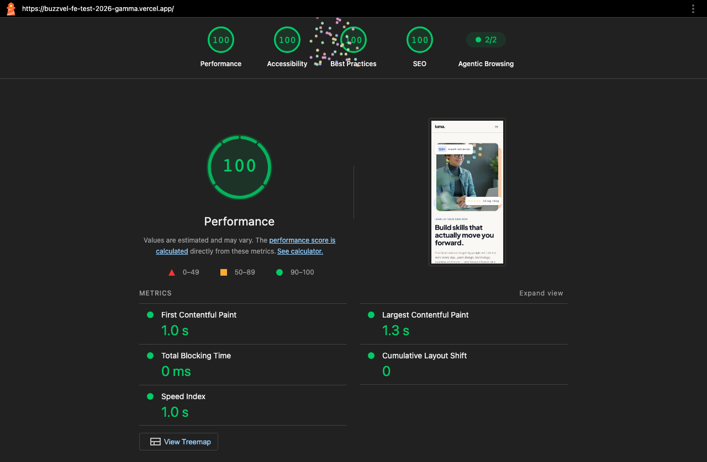
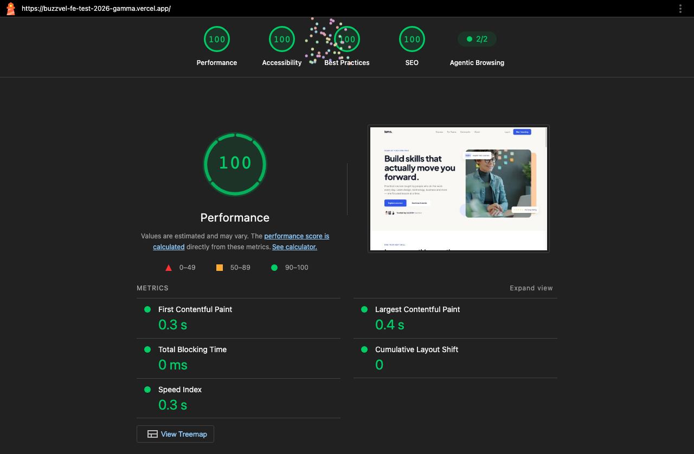

# Luma Learning · Buzzvel Front-End Challenge

An implementation of the Luma Learning landing page for the Buzzvel take-home challenge, based on the [supplied Figma design](https://www.figma.com/design/G0zSf6gyynwzEusOCgm2CM/Buzzvel-FE---Test-2026?node-id=0-1).

**Live demo:** [Luma Learning on Vercel](https://buzzvel-fe-test-2026-gamma.vercel.app/).

## Setup and development

Use **Node.js 22** (`.nvmrc`) and **Yarn Classic 1.22.22**. From the repository root, with nvm installed:

```sh
nvm install
nvm use
corepack enable
corepack prepare yarn@1.22.22 --activate
yarn install --frozen-lockfile
yarn dev
```

Open [localhost:3000](http://localhost:3000). Node 22 includes Corepack; its setup commands are only needed when the pinned Yarn version is not already active. Commit dependency changes with `yarn.lock`.

For a production build:

```sh
yarn build
yarn start
```

The production server also uses port 3000. No environment variables are required locally. For deployment, optionally set `SITE_URL` to the public origin for absolute metadata URLs; otherwise the app uses `VERCEL_PROJECT_PRODUCTION_URL` when available, then `http://localhost:3000`. An Open Graph image is generated by `src/app/opengraph-image.tsx`.

## Stack and implementation decisions

- Next.js 16.4.6 App Router, React 19, strict TypeScript 5.9 and Tailwind CSS 4.
- Storybook 10.6.7, Playwright 1.65.1, Vitest, axe, ESLint and Prettier support component documentation and verification.
- The page includes the header, hero, course categories, featured course, learning steps, testimonial, community, contact form, final CTA and footer. Desktop and mobile Figma layouts guide the implementation, with tablet adaptations and responsive layouts from 320px to 2560px.
- Static sections use Server Components; navigation, course previews and the form isolate the interactive client code. Shared primitives live in `src/components/ui`, composed sections in `src/components/sections`, and local content in `src/data`. Imports use the root alias, for example `@/src/components/ui/container`.
- Tailwind theme tokens in `src/styles/global.css` centralize colors, typography and shadows. Inter and Plus Jakarta Sans are hosted locally, with small core subsets and extended Unicode fonts loaded on demand. Font licenses are included in `public/fonts`.
- The hero uses pre-generated AVIF/WebP sources at three sizes with responsive selection and high-priority loading. Other content images use server-generated Next.js image optimization attributes.
- Native `<dialog>` elements provide modal navigation and course previews, including keyboard dismissal and focus restoration. The drawer closes at the desktop breakpoint. Course previews show their small local dataset immediately, with subtle opening and closing motion that respects reduced-motion preferences.
- The page provides semantic landmarks, a skip link, visible focus styles, labelled inputs, error announcements and reduced-motion support.

## Scope and known limitations

- Course previews use local sample content where the design does not specify details. Their CTA leads to the contact section; there is no enrollment flow.
- The contact form validates input and simulates a 600ms submission locally. It does not send email, store messages or contact a server. JavaScript is required, and submission stays disabled until the form is ready.
- Navigation and design actions resolve to page sections. Log in, Careers, Journal, Terms and Privacy are placeholders for a future product, without dedicated pages or authentication.
- A backend, CMS, authentication and payment integration are outside the challenge scope.
- Automated accessibility checks cover selected page and dialog states. They do not establish complete accessibility compliance; broader browser, assistive technology and visual review remains useful.

## Verification

```sh
yarn run check
yarn build
yarn playwright install chromium
yarn test:e2e
yarn build-storybook
yarn vitest run --project=storybook
```

`yarn run check` runs the project's ESLint, TypeScript and Prettier checks; `yarn check` is a separate Yarn Classic command. Playwright starts the production server on port 3106, so run `yarn build` before the end-to-end suite. The suite covers page sections and anchors, desktop/mobile/tablet interactions, form validation and submission, dialog keyboard behavior, axe checks, and overflow/clipping across widths from 320px to 2560px. Storybook's browser tests exercise component stories and their interaction assertions in Chromium.

Regression tests also cover resizing an open mobile menu into the desktop layout, preventing native form submissions without JavaScript, opening local course details while offline, and dismissing course previews with keyboard, backdrop and reduced-motion interactions.

Validation on November 19, 2026, with Node 22.23.5 and Yarn 1.22.22: quality checks and both builds passed; 38 end-to-end tests passed, with one mobile-menu test intentionally skipped in the desktop project; all 36 Storybook tests passed. A frozen offline installation, quality checks and both builds also passed in a clean temporary copy, without changing dependency versions.

To browse the component documentation:

```sh
yarn storybook
```

Open [localhost:6006](http://localhost:6006). `yarn build-storybook` exports the static documentation to `storybook-static/`.

## Lighthouse results

Audited the [live Vercel deployment](https://buzzvel-fe-test-2026-gamma.vercel.app/) on November 19, 2026, using Lighthouse 13.5.0 and Chrome 157.0.8103.79. Mobile results are the medians of five sequential runs with fresh browser profiles, storage reset and default simulated Slow 4G/4× CPU throttling. Desktop results come from one run with the default desktop preset. All five mobile runs scored 100 in each category below.

| Profile                  | Performance | Accessibility | Best Practices | SEO |
| ------------------------ | ----------: | ------------: | -------------: | --: |
| Mobile (five-run median) |         100 |           100 |            100 | 100 |
| Desktop (one run)        |         100 |           100 |            100 | 100 |

Mobile median metrics: FCP **0.99s**, LCP **1.26s**, Speed Index **0.99s**, TBT **7ms** and CLS **0**. The mobile screenshot shows the actual run with the median LCP; other metrics in that individual report can differ slightly from their five-run medians. Scores may vary with hardware, browser versions and measurement conditions.

<details>
<summary>Mobile Lighthouse screenshot — Vercel deployment</summary>



</details>

<details>
<summary>Desktop Lighthouse screenshot — Vercel deployment</summary>



</details>

## AI assistance and time

OpenAI Codex assisted with implementation, refactoring, tests, documentation and code review. The `performance`, `core-web-vitals` and `vercel-react-best-practices` skills also supported performance analysis, alongside Lighthouse audits and Chrome DevTools. The validation commands above check generated changes through linting, strict types, formatting, builds and browser interactions. Human visual and functional review remains necessary, particularly when comparing the result with Figma.

Approximate time spent: 4 hours (author estimate).
